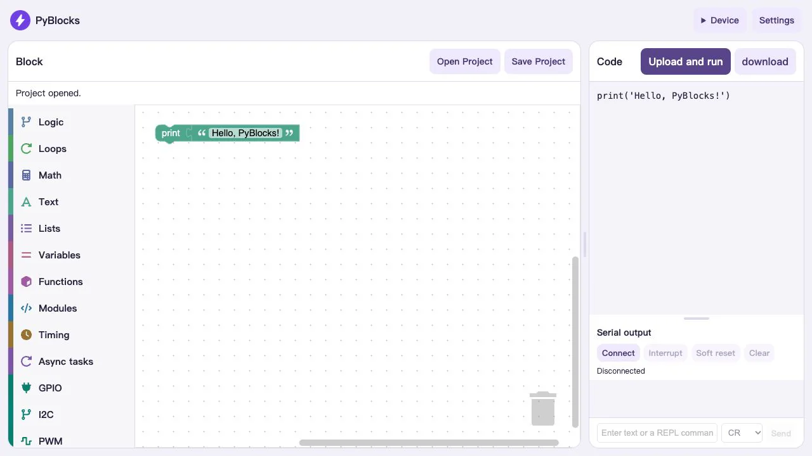

<div align="center">
  
  <h1>PyBlocks</h1>
  <p><strong>Build with blocks. Run real MicroPython.</strong></p>
  <p>A browser-based programming workspace for ESP32, Matrix:bit, micro:bit, and Raspberry Pi Pico.</p>
  <p><a href="https://blocks.lsong.org/"><strong>Open the editor →</strong></a> · <a href="docs/user-guide.md">Beginner’s guide</a> · <a href="examples/">Examples</a></p>
  <a href="https://github.com/lsongdev/pyblocks/actions/workflows/pages.yml"></a>
</div>

[](docs/user-guide.md)

## Design philosophy

Write programs first and choose hardware later. All supported hardware capabilities remain discoverable in one toolbox, without requiring a board selection before editing. See [Product and device design](docs/design.md) for the design principles and proposed deployment experience.

## Features

- Visual blocks with editable Python, project import/export, and local autosave.
- GPIO, ADC, PWM, sensors, displays, and board-specific peripherals.
- Wi-Fi, HTTP, MQTT, NTP, exception handling, and asynchronous tasks.
- USB upload, firmware installation, device files, and an interactive serial console.
- English and Simplified Chinese, with offline support as an installable PWA.

## Quick start

1. Open **[blocks.lsong.org](https://blocks.lsong.org/)** in desktop Chrome or Edge.
2. Connect your board over USB. If needed, click **Install MicroPython firmware** and select your board. Installation replaces existing programs and files; back up first.
3. Start with the default **Say hello** blocks or open an [example project](examples/).
4. In the **Device** panel, click **Upload and run**, select the serial port, and read the console output. The **Code** panel below can be expanded or collapsed independently.

New to programming? Follow the illustrated **[Beginner’s Guide](docs/user-guide.md)** to say hello, blink an LED, and ask a question. Use **Save Project** to keep a portable backup of your work.

The installer supports classic ESP32 Matrix:bit (8 MB), XiaoMiao (4 MB + PSRAM), micro:bit V1/V2, and the original RP2040 Pico. Pico installation requires BOOTSEL mode and WebUSB. Networking blocks target the project's ESP32 firmware; available APIs depend on your board and firmware. Close other applications using the serial port before connecting.

SPIKE Prime blocks target the official SPIKE App 3 Python API. **Upload and run** identifies the selected USB hub, asks for a program slot on first connection, uploads and starts the program, and streams console output. Subsequent uploads reuse the confirmed connection and slot. Use desktop Chrome or Edge and disconnect the LEGO SPIKE App before choosing the hub. See the [SPIKE Prime guide](docs/spike-prime.md).

M5Stack Core/Basic (4 or 16 MB) and original M5Stick-C (4 MB) use model-specific UIFlow2 firmware. See the [M5Stack guide](docs/m5stack.md) for installation, display, buttons, and Stick-C sensors.

Shared [condition events](docs/events.md) offer synchronous and asyncio blocks; hardware updates remain explicit. SPIKE retains its own runloop.

## Development

Requires Node.js 24+.

```sh
git clone https://github.com/lsongdev/pyblocks.git
cd pyblocks
npm ci
npm run dev
```

`npm test` runs the automated checks; `npm run build` creates the production site in `dist/`. Firmware preparation runs automatically before development and builds. Pushes to `main` deploy to GitHub Pages.

Block definitions and Python generators live in `src/blocks/`, editor UI in `src/editor/`, device communication in `src/device/`, and installers in `src/firmware/`.

## License

[MIT](LICENSE) © Lsong. Third-party dependencies and firmware retain their respective licenses.
