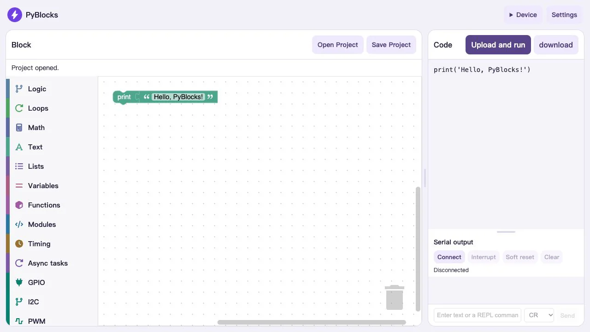
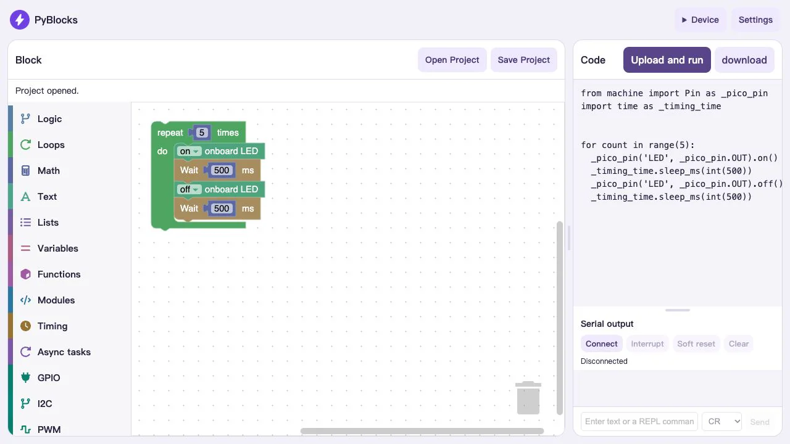
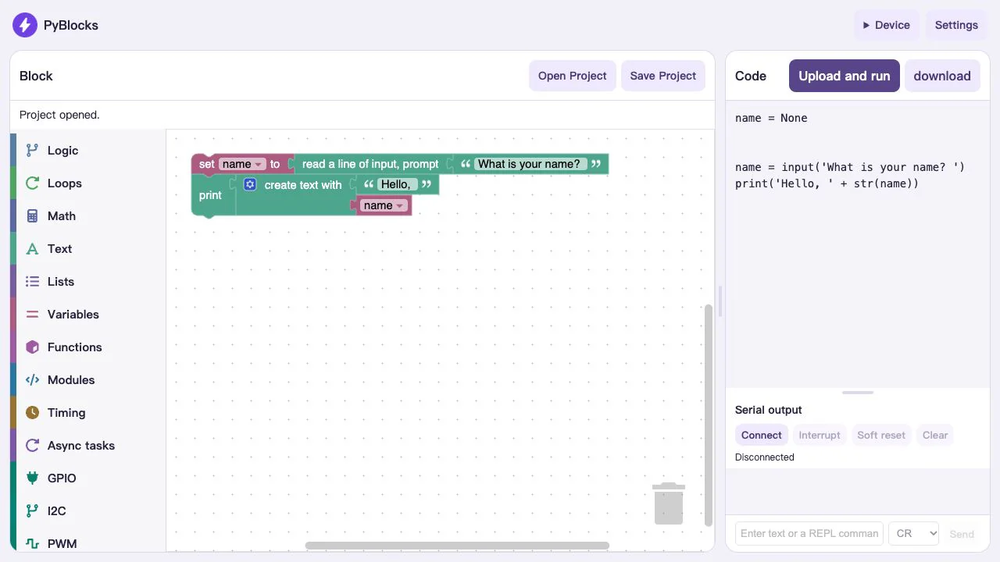
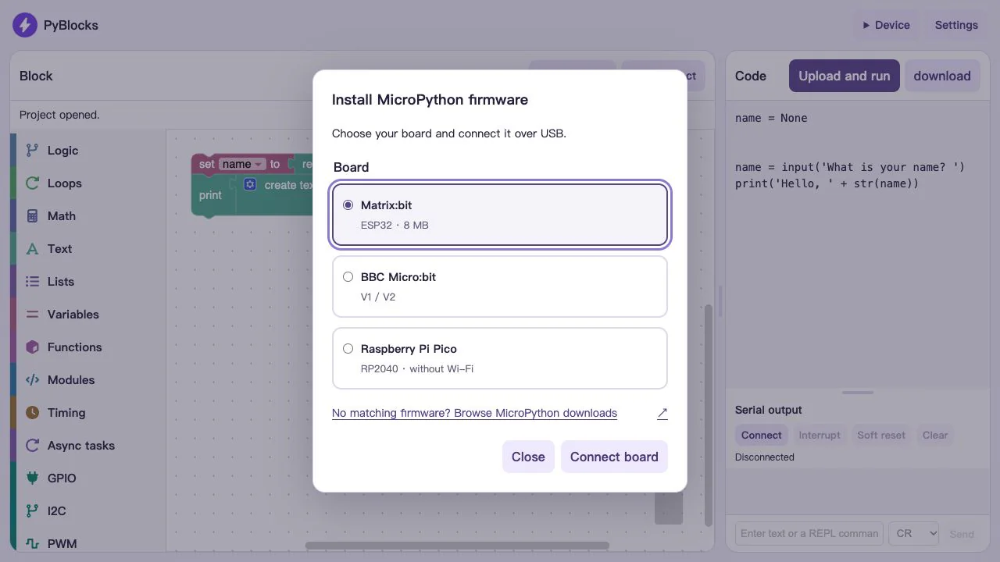

# Your First Adventures with PyBlocks

**Make your board say hello, blink a light, and ask you a question.**

You do not need to know Python to begin. You will build programs by joining blocks, then see the Python that they make.

[Open PyBlocks](https://blocks.lsong.org/) · [Back to the project](../README.md)

## Choose your adventure

| Adventure | You will learn | What you need |
| --- | --- | --- |
| [1. Say hello](#1-say-hello) | Text and running a program | Any supported board |
| [2. Make a light blink](#2-make-a-light-blink) | Order, waiting, and repeating | An original Raspberry Pi Pico |
| [3. Ask a question](#3-ask-a-question) | Input and variables | Any supported board |
| [4. Learn from a mistake](#4-learn-from-a-mistake) | Handling an error | Any supported board |

The pictures use the **English** interface. You can change the language in **Settings**.

## Before you begin

Bring a supported board, a USB **data** cable, and a computer with Chrome or Edge. A charging-only cable will not work for sending programs.

Ask a teacher or grown-up to help with the first USB connection. If your board needs MicroPython installed, use the [setup notes for grown-ups](#setup-notes-for-grown-ups) at the end of this guide.

**You can explore the blocks without a board. You need a board to run the program.**

## Meet your workspace



*This is the real editor before connecting a board. The console buttons become available after connecting.*

Think of the screen as three work areas:

| Where? | What happens there? |
| --- | --- |
| **Left: Block** | Pick a category, drag blocks out, and join them together. |
| **Right: Code** | See the Python made by your blocks. You do not need to edit it yet. |
| **Bottom right: Serial output** | Read messages from your board and send answers back. |

A **program** is a set of instructions. Connected blocks run from top to bottom. A block that fits inside another block gives it a value, such as a message or a number.

## 1. Say hello

**Your mission:** make the board send you a message.

[Download the finished hello project](../examples/beginner-hello.blockly.json) if you would like to follow along with the blocks already assembled.

### Build it

1. Open **Text** in the toolbox on the left.
2. Drag a **print** block onto the empty workspace.
3. Click its text and type `Hello, PyBlocks!`.
4. Look at Code. You should see a line like this:

```python
print('Hello, PyBlocks!')
```

Your blocks should look like the picture above. `print` sends a message to the console; it does not print on paper.

### Send it to your board

1. Connect the board with its USB cable.
2. Click **Upload and run**.
3. With your teacher, choose the board's USB serial device in the browser window.
4. Keep the cable plugged in while the program is sent.
5. Look in **Serial output** for your message:

```text
Hello, PyBlocks!
```

You might also see startup messages from MicroPython. That is normal.

### Change one thing

Replace the message with `I made a program!`, then upload again.

**Think about it:** what do you predict will happen if you connect two print blocks, one underneath the other?

**Try it:** make the board tell a two-line joke. Keep the question above the answer.

### Keep your work

Click **Save Project** and keep the downloaded `.json` file. Give the file a name you can remember, such as `my-first-hello.blockly.json`. To use it later, click **Open Project**.

## 2. Make a light blink

**Your mission:** repeat a short set of instructions.

This adventure uses the **original Raspberry Pi Pico** and its built-in LED. You do not need to attach a separate light or wires. Pico W and Pico 2 need different support and are not the target of this example.

[Download the finished Pico blink project](../examples/beginner-pico-blink.blockly.json).



### Build it

1. From **Loops**, add a **repeat** block and change its number to `5`.
2. From **Pico**, place an **on onboard LED** block inside the repeat block.
3. From **Timing**, add **Wait 500 ms** underneath it.
4. Add **off onboard LED** next.
5. Add another **Wait 500 ms** at the bottom.

Join the four inside blocks in the same order as the picture. A wait gives you time to see the light before the next instruction runs.

**500 milliseconds is half a second. 1,000 milliseconds is one second.**

### Predict, then run

Before uploading, count how many times you think the light will turn on. Now upload the program to your Pico and watch it.

### Change one thing

- Change `5` to `10`. What changes?
- Change both waits from `500` to `200`. Is the blink faster or slower?
- Make the light stay on longer than it stays off.

**Think about it:** why do we put a wait after turning the light off, too?

### Using a different board?

Keep the idea of **show something → wait → change it → wait**, but choose blocks for your board:

| Board | A version to try |
| --- | --- |
| **micro:bit V1 or V2** | Under **Micro:bit → Display**, show a HEART image, wait, then show HEART_SMALL and wait again. |
| **Matrix:bit** | Under **Matrix:bit → Display**, draw a short message and flush the display, wait, then clear and flush it before waiting again. |

Use only the branch for the board you have. The Pico LED blocks are not for a micro:bit or Matrix:bit.

## 3. Ask a question

**Your mission:** let the board remember your answer.

[Download the finished name project](../examples/beginner-name.blockly.json).



A **variable** is a named place to keep a value. Here, `name` keeps the answer you type.

### Build it

1. Open **Variables**, create a variable called `name`, and drag out **set name to**.
2. From **Text**, put **read a line of input** into its value slot.
3. Set the question to `What is your name? `.
4. Add a **print** block underneath the set block.
5. Put a **create text with** block inside print.
6. Join the text `Hello, ` with a **name** variable block, as in the picture.

Leave a space after the comma in `Hello, ` so your answer does not run into the greeting.

### Have a conversation

1. Upload the program.
2. Wait for `What is your name?` in Serial output.
3. Click the input box at the bottom of the console.
4. Type a short name such as `Alex`, keep the line ending set to **CR**, and press **Enter** or **Send**.
5. Look for the greeting:

```text
What is your name? Alex
Hello, Alex
```

The board may echo your answer as you type or send it. The exact line layout can vary by firmware.

The program waits at the question until you answer. This is what `input()` does.

### Change one thing

Ask `What is your favorite animal? ` and make the reply start with `I like `.

**Think about it:** what value is kept in `name` after you answer? Would a different variable name make your animal program easier to understand?

**Typing tip:** on the project's ESP32 firmware, the built-in line editor accepts ordinary ASCII characters. Use a name such as `Alex` for this activity; Chinese characters typed into native `input()` are filtered by that firmware. Programs can still display Unicode output.

### Three helpful console buttons

| Button | What to expect |
| --- | --- |
| **Interrupt** | Ask the running program to stop. You may see `KeyboardInterrupt`; you have not broken the board. |
| **Soft reset** | At the `>>>` prompt, restart the saved program so it can ask its question again. Interrupt a running program first. |
| **Clear** | Clear messages from the screen. The program itself keeps running. |

Press **↑ / ↓** in the input box to revisit recently sent text. Use **Connect** if the console is disconnected. Keep **CR** selected while following these activities.

## 4. Learn from a mistake

**Your mission:** help a program respond when an answer is not what it expected.

An **error** means the program could not follow an instruction. Errors are clues. Programmers use them to learn what needs changing.

This activity starts from the [input and exceptions project](../examples/serial-input-exceptions.blockly.json). Ask your teacher to help download and open it. It is longer than the name program, so you do not need to build it from memory.

### Try two answers

1. Upload the example and wait for `Integer> `.
2. Type `42` and send it. The program should accept the number.
3. At the next question, type `hello` and send it.
4. Look for an error message and `Finished this attempt`.
5. Try another number. The program is still ready for you.

An **integer** is a whole number, such as `0`, `7`, or `42`. The word `hello` cannot be turned into one.

### Follow the three paths

Find the exception-handling blocks under **Logic**:

| Part | Read it as… |
| --- | --- |
| **try** | “Try to turn this answer into a number.” |
| **catch ValueError** | “If the answer cannot become a number, show the error.” |
| **finally** | “Finish this attempt, whether the answer worked or not.” |

The example uses an **int** Python-call block to turn text into a whole number. You can leave that block as it is while you explore the error-handling parts.

**Change one thing:** change the catch body's printed message to `Please type a whole number.`.

**Think about it:** why is it helpful for the program to ask again after a mistake?

Click **Interrupt** when you want to stop the repeating questions.

## Make something of your own

Choose a small challenge:

- **Robot introduction:** print three messages about an imaginary robot.
- **Light pattern:** make a Pico blink two quick times, then pause.
- **Friendly greeter:** ask a question and include the answer in a new sentence.
- **Helpful number reader:** keep asking for a whole number after an invalid answer.

Change one thing at a time. Predict what will happen, run the program, and compare what you saw with your prediction.

## When something does not work

| What happened? | Try this |
| --- | --- |
| Nothing appears in the console | Check the USB cable, upload status, and connection. A charging-only cable cannot send data. |
| The board is waiting and looks stuck | It might be waiting for your answer. Read its last question and send a line with CR. |
| You cannot find the board in the chooser | Ask your teacher to check the cable, browser, USB mode, and whether another app is connected. |
| The blocks will not join | Check their shapes. A value block belongs in a value slot; instruction blocks join in a stack. |
| The program runs in the wrong order | Follow connected blocks from top to bottom. |
| The light does not blink | Check that the example matches your board and that there is a wait after both on and off. |
| You changed blocks but the old program still runs | Upload again. If Code has manual edits, ask your teacher about **Use generated code**. |
| You see a red error or a traceback | Read the last line with a teacher. It often tells you which instruction needs attention. |

If you need to start again, save your project first. You can reopen a finished example and try a smaller change.

## Setup notes for grown-ups

The activities use the English interface on [PyBlocks](https://blocks.lsong.org/). English and Simplified Chinese can be selected in Settings. A supported desktop browser and HTTPS or localhost are needed for device connections.

### Firmware installation

If compatible MicroPython is already installed, start with the hello activity. Otherwise:

1. Back up any board files you want to keep.
2. Open **Install MicroPython firmware**.
3. Select the exact board model and choose **Connect board**.
4. Select its USB device, review the detected board and warning, and confirm installation.
5. Keep USB connected until writing and verification finish.



*This picture shows the board-selection step, before connecting or installing anything.*

Installation replaces existing programs and files. Program uploads write `main.py` and attached libraries. The original Pico requires **BOOTSEL** mode and WebUSB for firmware installation, then normal MicroPython mode for program uploads. Close other applications using the serial port.

### Downloading and saving lessons

Each lesson link opens a project file in the repository. Download its raw `.blockly.json` file, then select it with **Open Project**. Do not save the GitHub HTML page as the project.

**Save Project** backs up blocks and attached libraries; **download** exports only the current Python code. Autosave belongs to the current browser profile and site address, so exported files are the portable backup. Open Project replaces the current workspace.

Keep Code as generated for these activities. Manual edits are preserved separately and can be replaced using **Use generated code**. Credentials entered in future network projects are included in exports; remove them before sharing classroom work.

### Further adventures

When learners are comfortable with sequence, repetition, variables, and input, explore the [other example projects](../README.md#examples). Wi-Fi, HTTP, MQTT, NTP, and asynchronous tasks need more setup and are better introduced as separate lessons. Networking examples currently target the supplied ESP32 firmware. See the [runtime notes](../README.md#runtime-notes) for firmware limits.

The editor can also be installed as a PWA for offline use after its initial assets have cached. Offline editing still needs a suitable browser for USB access, and Internet services still need a network connection.
